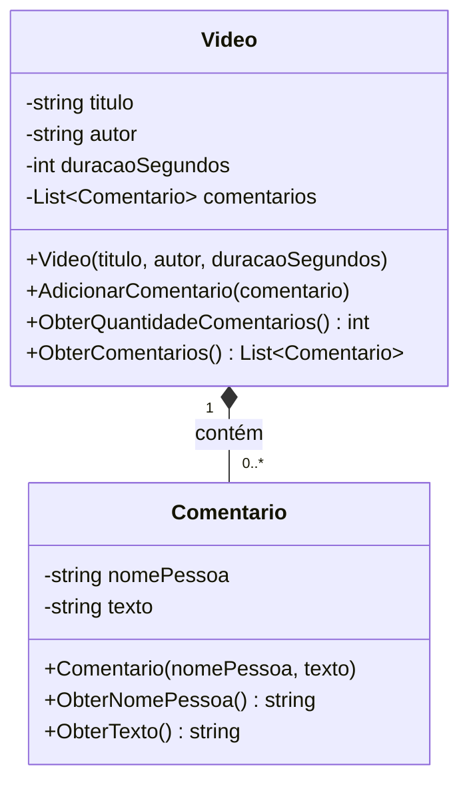
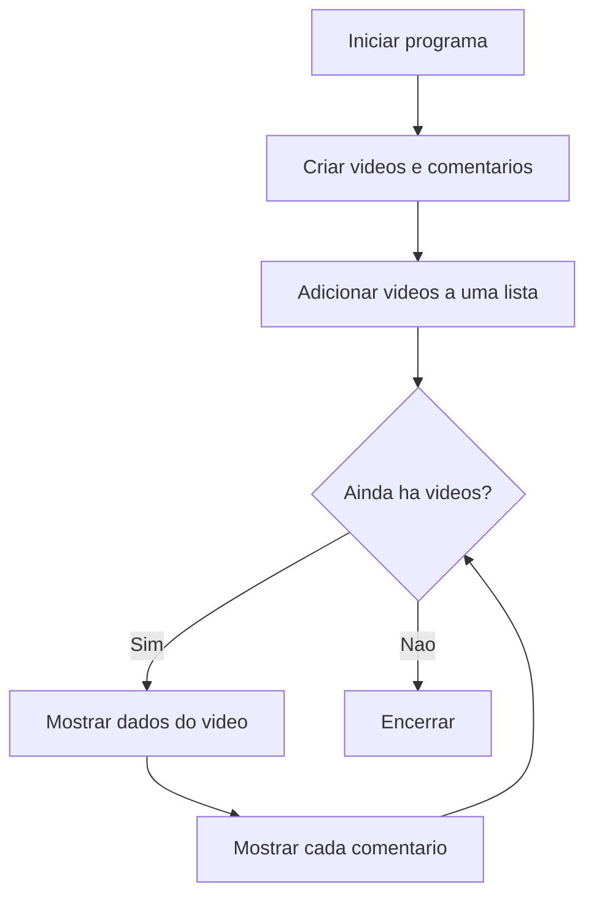
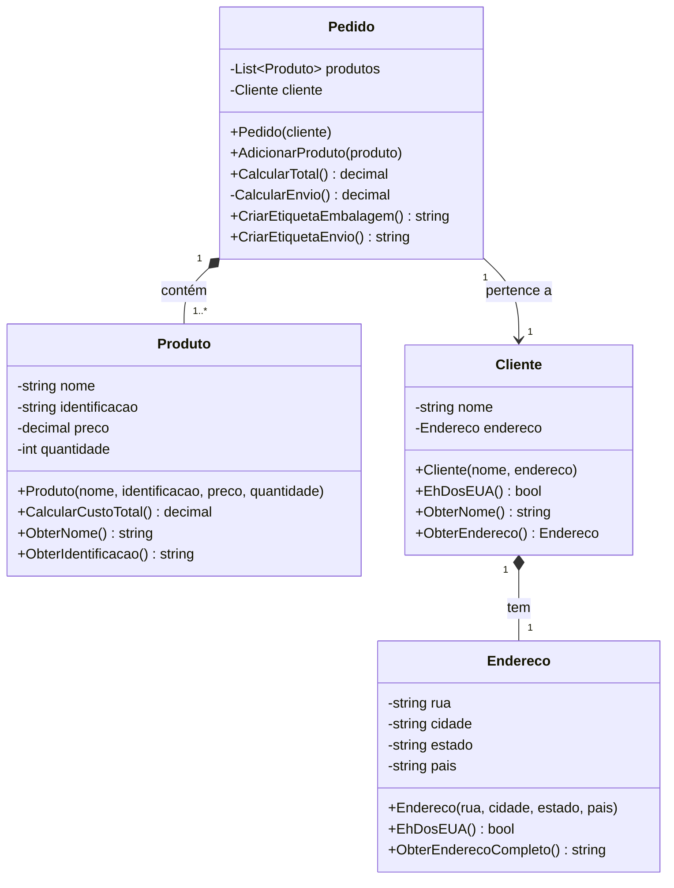
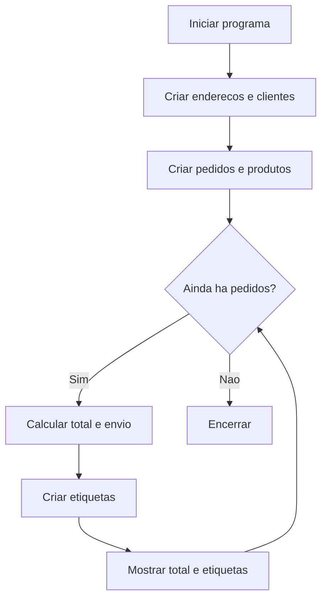

# Design dos Programas de Fundamentos

Este documento apresenta meu design individual para os dois programas. Os dados serão criados diretamente no `Program.cs`; não haverá menu nem entrada do usuário.

## Programa 1: Vídeos do YouTube

### O que o programa faz

O programa guarda informações sobre vídeos e comentários. Depois, percorre uma lista de vídeos e mostra os dados de cada vídeo, a quantidade de comentários e o texto de cada comentário. O programa não acessa o YouTube.

### Classes e responsabilidades

| Classe | Responsabilidade |
| --- | --- |
| `Video` | Guardar o título, autor, duração e comentários de um vídeo. Também informa quantos comentários existem. |
| `Comentario` | Guardar o nome da pessoa e o texto de um comentário. |

### Diagrama de classes

### Como o programa será executado

1. `Program.cs` cria de 3 a 4 objetos `Video` com título, autor e duração.
2. Para cada vídeo, cria e adiciona de 3 a 4 objetos `Comentario`.
3. Coloca os vídeos em uma lista.
4. Percorre a lista e mostra título, autor, duração e quantidade de comentários.
5. Para cada vídeo, percorre seus comentários e mostra o nome e o texto de cada um.

## Programa 2: Pedidos Online

### O que o programa faz

O programa guarda pedidos com produtos e clientes. Ele calcula o preço total, incluindo o envio, e cria uma etiqueta de embalagem e uma etiqueta de envio para cada pedido.

### Classes e responsabilidades

| Classe | Responsabilidade |
| --- | --- |
| `Produto` | Guardar nome, identificação, preço e quantidade. Calcular o custo total daquele produto. |
| `Endereco` | Guardar rua, cidade, estado e país. Informar se o endereço fica nos EUA e formatar o endereço completo. |
| `Cliente` | Guardar nome e endereço. Perguntar ao endereço se o cliente mora nos EUA. |
| `Pedido` | Guardar os produtos e o cliente. Calcular o total e criar as etiquetas de embalagem e envio. |

Todas as variáveis membro serão privadas. Os construtores inicializam os objetos e os métodos públicos permitem consultar os dados ou pedir que os cálculos sejam feitos.

### Diagrama de classes

### Regras de cálculo e etiquetas

- O custo de cada produto é `preço × quantidade`.
- O envio custa `$5` se o cliente mora nos EUA e `$35` caso contrário.
- O total do pedido é a soma dos custos dos produtos mais uma cobrança de envio.
- A etiqueta de embalagem lista o nome e a identificação de cada produto.
- A etiqueta de envio mostra o nome do cliente e o endereço completo.

### Como o programa será executado

1. `Program.cs` cria objetos `Endereco` e `Cliente`.
2. Cria pelo menos dois objetos `Pedido`, cada um com 2 ou 3 produtos.
3. Para cada pedido, solicita o total, a etiqueta de embalagem e a etiqueta de envio.
4. Mostra esses resultados na tela.

